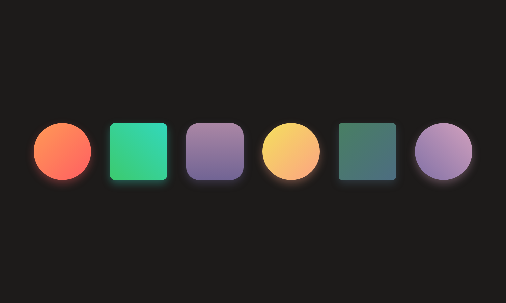
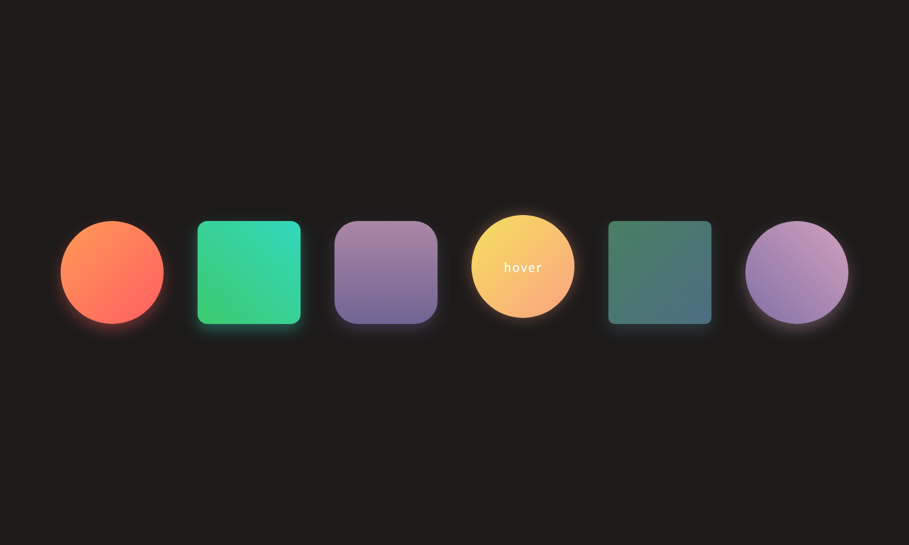

# HTML + CSS 形状悬停效果

课后任务 9.29：用 HTML + CSS 做出六个形状，鼠标滑过时形状上移 10 个像素、阴影偏移量变为 0、形状中间出现 `hover` 字样。

## 效果预览

默认状态：



鼠标悬停状态（示例为黄色圆形被滑过时）：



## 文件说明

| 文件 | 说明 |
| --- | --- |
| `index.html` | 全部源码，HTML 和 CSS 写在同一个文件里 |
| `preview-default.png` | 默认状态截图 |
| `preview-hover.png` | 悬停状态截图 |

用浏览器直接打开 `index.html` 就能看到效果。

## 实现思路

`.c1` 是上课完成的案例，其余五个形状沿用同一套写法：**渐变背景 + 圆角 + 阴影 + 悬停效果**，颜色和形状照着效果图还原。

形状中间的 `hover` 字样用伪元素生成，默认隐藏，鼠标滑过时才显示：

```css
.cube::after{
    content: "hover";
    opacity: 0;
    transition: opacity .3s ease;
}

.cube:hover{
    transform: translateY(-10px);                  /* 上移 10 个像素 */
}

.cube:hover::after{
    opacity: 1;                                    /* 显示 hover 字样 */
}

.c1{
    box-shadow: 0 10px 24px rgba(255, 94, 98, .35);
}

.c1:hover{
    box-shadow: 0 0 24px rgba(255, 94, 98, .35);   /* 阴影偏移量变为 0 */
}
```

## 用到的知识点

- 弹性盒布局 `display: flex` 与 `gap` 间距
- `border-radius`：直角方形、圆角方形、圆形
- `linear-gradient()` 线性渐变
- `box-shadow` 阴影
- `::after` 伪元素显示文字
- `:hover` 与 `transition` 过渡动画
